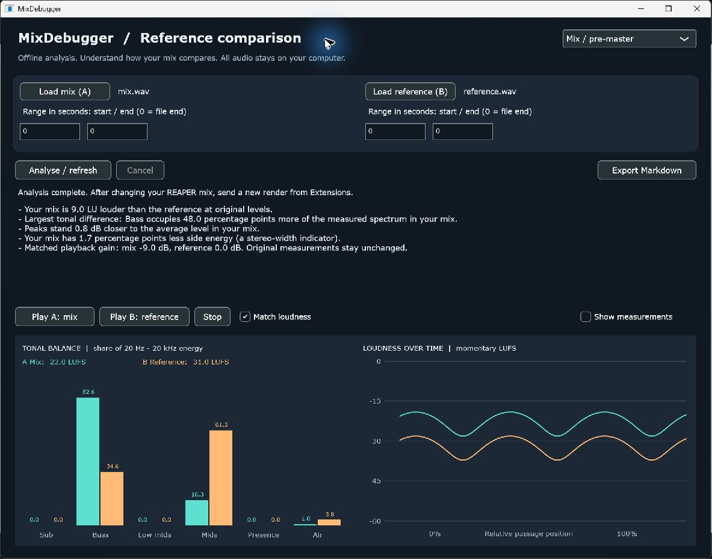

# MixDebugger

**Understand how your mix compares to a reference track.**

MixDebugger is a local, offline audio analyser for mixes, pre-masters and finished
masters. Load two tracks, select comparable passages and see their differences in
loudness, dynamics, tonal balance and stereo. Listen with loudness-matched A/B
playback, then export a readable Markdown report.



The Windows application can run beside REAPER. Its optional extension renders the
current master output and opens it in MixDebugger. Analysis never applies EQ,
compression, gain, pan, phase or FX changes to your project.

## Workflow

1. Load your mix, or use **Extensions > MixDebugger: compare mix with reference...**
   in REAPER. A REAPER time selection limits the rendered passage; otherwise the
   whole project is rendered.
2. Load a reference audio file. Keep the reference outside the REAPER master path
   so it is not processed by your project's master FX.
3. Leave both ranges at `0 / 0` for whole files, or enter independent start/end
   times in seconds. An end of `0` means the end of that file.
4. Choose **Analyse / refresh**. Analysis runs in a background worker and can be
   cancelled. The audio files stay on your computer.
5. Read the difference summary and compare the graphs. Open **Show measurements**
   for the full report and definitions.
6. Use **Play A** / **Play B** with **Match loudness** enabled. Switching preserves
   elapsed time within each selected passage; it does not synchronise beats.
7. Export the report with **Export Markdown**.

A reference is optional. Without one, the application produces a single-file
measurement report. After editing a REAPER project, send a fresh render from its
Extensions menu; existing results describe the previous snapshot.

## Measurements

| Area | Outputs |
| --- | --- |
| Loudness | Integrated LUFS, momentary and short-term history |
| Peaks | Sample peak, true peak |
| Dynamics | Loudness range (LRA), RMS, crest factor |
| Tone | Energy shares in six frequency bands, mix-minus-reference differences |
| Stereo | L/R correlation, side energy, side energy by band, mono energy change |
| Time | Momentary loudness graph and selected passage boundaries |

Descriptions are observations, not quality scores or instructions to change your
mix. Level-independent band shares separate tonal differences from the simple
fact that one file is louder. See [measurement definitions](docs/measurements.md).

## Build on Windows

Requirements: Visual Studio 2022 Build Tools with **Desktop development with C++**,
Windows SDK, CMake 3.25+, Git and network access for the initial dependency fetch.
Use a Developer PowerShell with `cmake` and `ctest` available:

```powershell
cmake --preset msvc-debug
cmake --build --preset msvc-release --parallel 4
ctest --test-dir build/msvc-debug -C Release --output-on-failure
```

Outputs:

- App: `build/msvc-debug/app/MixDebuggerApp_artefacts/Release/MixDebugger.exe`
- REAPER extension: `build/msvc-debug/bridge/Release/reaper_mixdebugger.dll`
- Installer: `build/msvc-debug/dist/Release/MixDebuggerSetup.exe`

Run the app directly for standalone analysis. For the REAPER extension, close
REAPER before running the installer, then restart REAPER. Portable REAPER installs
need manual extension placement; see [REAPER integration](docs/reaper-integration.md).

For scripts, `build/msvc-debug/Release/mixdebugger.exe mix.wav reference.wav`
prints a whole-file Markdown comparison to stdout (the reference is optional).
The GUI also accepts `--mix-file`, `--reference-file` and `--analyse`.

## Project status

Version **0.2.0**, under development. The supported integration target is Windows
x64. Core/UI sources use JUCE, but other operating systems are not validated.
Supported inputs are mono/stereo files decoded by the JUCE build; WAV, AIFF and
FLAC are recommended. Surround analysis is deliberately rejected.

The project previously explored automatic stem corrections. The new application
and bridge do not expose that workflow. Older advisory modules and their tests
remain in the tree for development history; see [architecture](docs/architecture.md).

## Documentation

- [User guide](docs/user-guide.md)
- [Measurements, assumptions and limitations](docs/measurements.md)
- [REAPER setup and data flow](docs/reaper-integration.md)
- [Architecture](docs/architecture.md)
- [Validation checklist](docs/validation.md)
- [Example report](docs/example-report.md)
- [Contributing](CONTRIBUTING.md)
- [Changelog](CHANGELOG.md)
- [Third-party notices](THIRD_PARTY_NOTICES.md)

## Licensing

A license for this project's own code has not yet been selected by its author.
Publishing source on GitHub alone does not grant an open-source license. JUCE is
available under AGPLv3 or a commercial license; libebur128 and other dependencies
have their own terms. See [third-party notices](THIRD_PARTY_NOTICES.md) before
distributing binaries.
